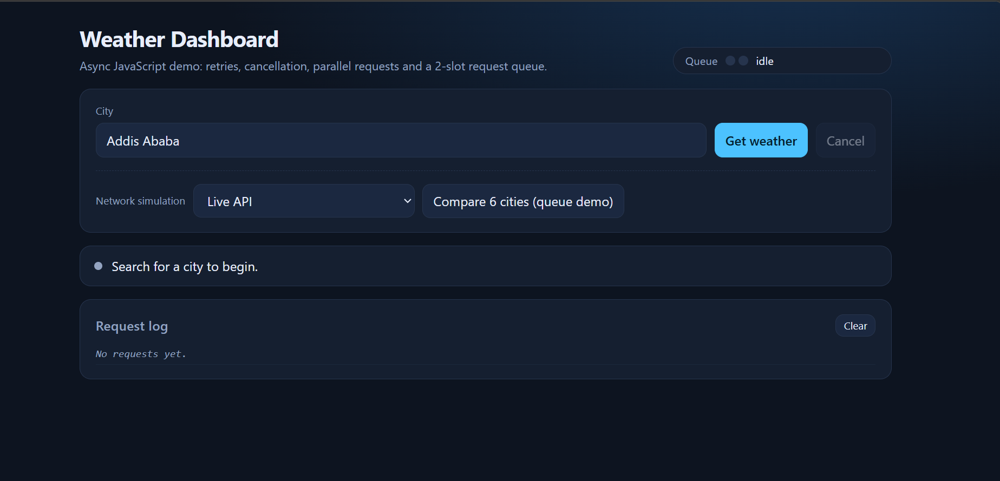

# Weather Dashboard

🔗 Live demo: https://weather-dashboard-one-azure.vercel.app

A weather app that demonstrates async JavaScript patterns.

## Features

- Search weather by city
- Automatic retries on failed requests
- Request cancellation
- Parallel requests (compare 6 cities)
- 2-slot request queue
- Request log

## Tech Stack

HTML, CSS, JavaScript, Weather API, deployed on Vercel

## Run locally

1. git clone https://github.com/SosinaTilahun/weather-dashboard.git
2. Open index.html in your browser

## Screenshot

